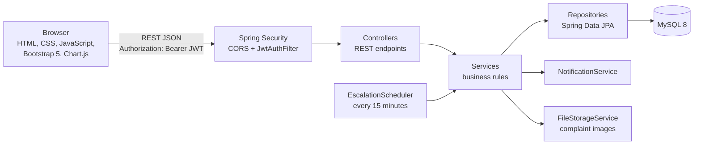
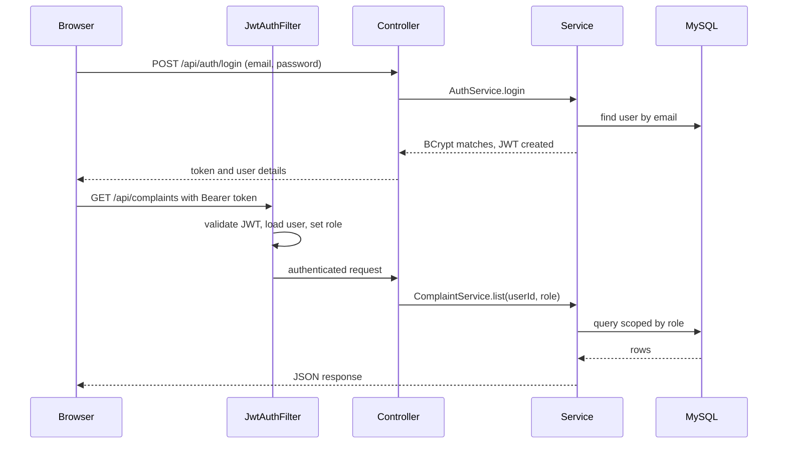
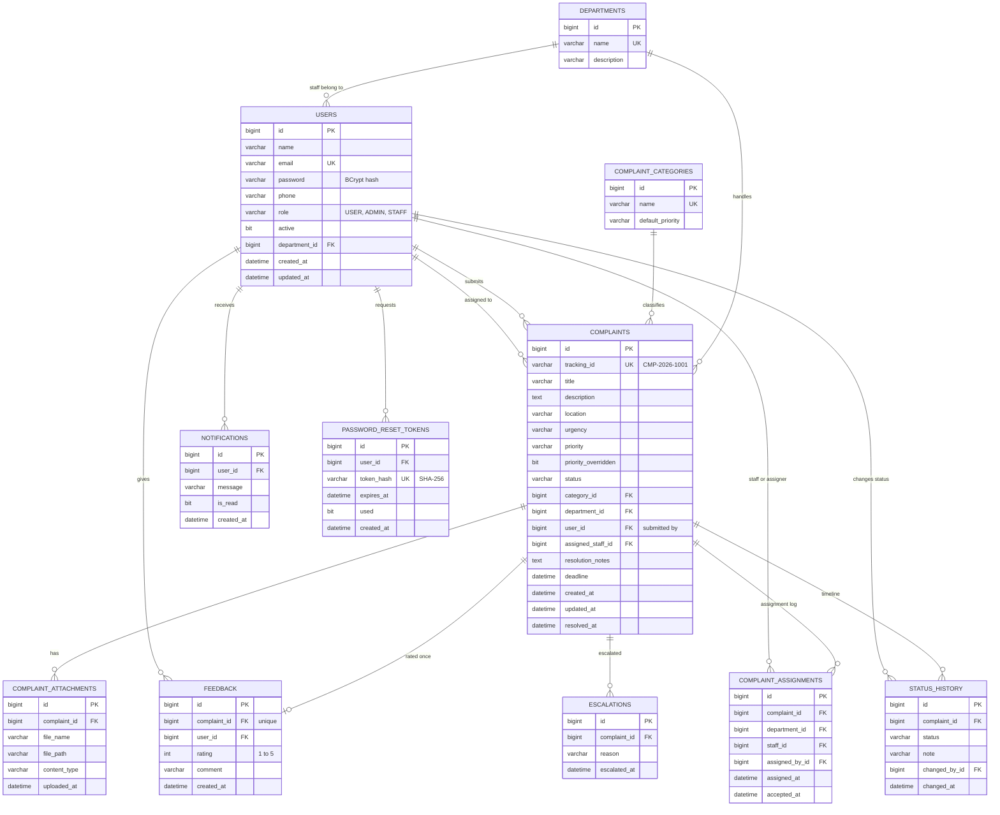
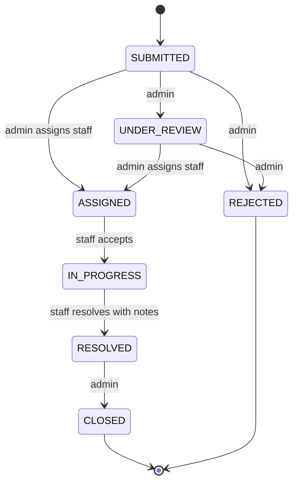

# Architecture and database design

The diagrams below are written in Mermaid. GitHub draws them automatically. To get a PNG for a report or PPT, paste the code block into https://mermaid.live and use Actions, PNG.

## 1. System architecture

Layers and responsibilities:

| Layer | Package | Responsibility |
|---|---|---|
| Controller | `controller` | Maps HTTP requests, validates input (`@Valid`), reads the logged in user, no business logic |
| Service | `service` | All business rules: priority, status transitions, assignment, feedback rules, analytics, escalation, paging |
| Repository | `repository` | Database access with Spring Data JPA, `@EntityGraph` to avoid N+1 queries, `Specification` for search |
| Entity | `entity` | JPA mapping of the 11 tables |
| DTO | `dto` | Request and response objects. Entities and password hashes are never sent to the client |
| Security | `security`, `config` | JWT creation and validation, filter, role rules, CORS, BCrypt |
| Exception | `exception` | One global handler that turns errors into JSON with the correct HTTP status |
| Scheduler | `scheduler` | Periodic overdue complaint check |

## 2. Login and request flow (JWT)

The server keeps no session. Every request carries the token, so the API is stateless.

## 3. Database design (ER diagram)

Design notes:
- Every table has a primary key and foreign keys. Frequently filtered columns are indexed (`complaints.status`, `priority`, `user_id`, `assigned_staff_id`, `notifications(user_id, is_read)`).
- `feedback.complaint_id` is unique, so a complaint can be rated only once.
- `status_history` is append only. It is the source of the tracking timeline.
- Reset tokens are stored only as SHA-256 hashes.

## 4. Complaint life cycle

Rules (class `StatusTransitions`, unit tested):
- Staff can only move ASSIGNED to IN_PROGRESS and IN_PROGRESS to RESOLVED, and only on complaints assigned to them.
- Admin can move to any status except out of CLOSED or REJECTED.
- RESOLVED needs resolution notes.
- Assigning a staff member to a new complaint sets the status to ASSIGNED automatically.

## 5. Smart priority and escalation

Priority (`PriorityCalculator`):
1. Start with the higher of the category default priority and the urgency chosen by the user.
2. If the title or description contains a critical keyword (fire, shock, short circuit, gas leak, collapse, electrocut, flood), the priority becomes CRITICAL.
3. If it contains a high keyword (leak, broken, danger, sparking, no water, power cut, accident, urgent), the priority is raised to at least HIGH.
4. Admin can override. The deadline is then recalculated.

Deadlines (`SlaPolicy`, configurable): Critical 24 h, High 72 h, Medium 120 h, Low 168 h from submission.

Escalation (`EscalationScheduler` and `EscalationService`):
1. Every 15 minutes the scheduler loads complaints whose deadline has passed and whose status is not RESOLVED, CLOSED or REJECTED.
2. Complaints that were already escalated are skipped.
3. For each new one an escalation record is saved ("Deadline exceeded by Nh") and every admin gets an in-app notification.
4. Admin can also trigger the same check from the Escalations page.

## 6. Where to find things in the code

| Topic | File |
|---|---|
| JWT create and validate | `security/JwtService.java` |
| Reads the token on every request | `security/JwtAuthFilter.java` |
| Role rules, CORS, BCrypt | `config/SecurityConfig.java` |
| Registration and login | `service/AuthService.java` |
| Priority rules | `service/PriorityCalculator.java` |
| Complaint submit, update, search | `service/ComplaintService.java`, `service/ComplaintSpecs.java` |
| Status rules | `service/StatusTransitions.java` |
| Escalation | `service/EscalationService.java`, `scheduler/EscalationScheduler.java` |
| Analytics | `service/AnalyticsService.java` |
| Password reset | `service/PasswordResetService.java`, `security/ResetTokens.java` |
| Error handling | `exception/GlobalExceptionHandler.java` |
| First run data | `config/DataInitializer.java` |
| Frontend API calls | `complaint-frontend/js/api.js` |
